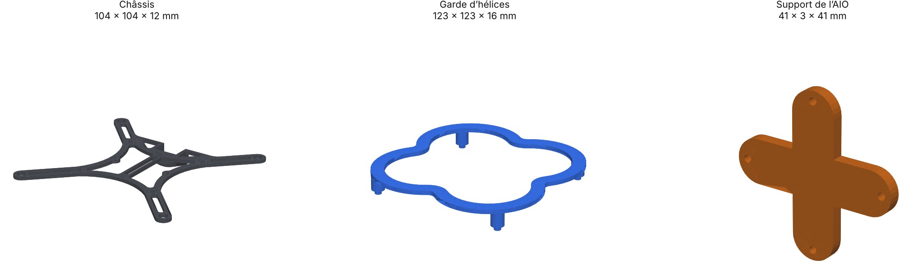
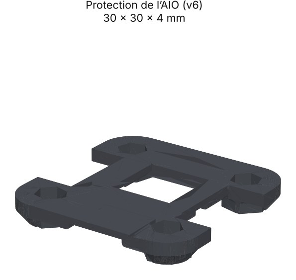

# Impression 3D — pièces conçues par moi

Pièces que j'ai modélisées sur Autodesk Inventor, puis imprimées en PLA sur ma Bambu Lab P1S : des pièces pour mes drones FPV, des objets du quotidien et une boîte de forme complexe.

## Contenu

| Dossier | Pièces |
|---|---|
| `stl/drone/` | Châssis de drone 2,5", garde d'hélices, support de l'AIO, protection de l'AIO du Flywoo LR4 (version 6) |
| `stl/cuisine/` | Support pour salière et poivrière, versions 1 et 2 |
| `stl/rangement/` | Boîte de rangement pour un jouet |
| `rendus/` | Rendus 3D des pièces |

## Pièces de drone

| Pièce | Dimensions | Rôle |
|---|---|---|
| Châssis | 104 × 104 × 12 mm | Châssis en croix d'un drone 2,5" |
| Garde d'hélices | 123 × 123 × 16 mm | Entoure les hélices pour les protéger |
| Support de l'AIO | 41 × 41 × 3 mm | Plaque de fixation de la carte AIO |

**Place des hélices sur le châssis.** On mesure les distances entre les centres des moteurs :

- entre deux moteurs opposés : 101,6 mm ;
- entre deux moteurs voisins : 73,3 mm ;
- une hélice de 2,5" mesure 2,5 × 25,4 = 63,5 mm de diamètre ;
- deux hélices voisines tournent chacune dans un cercle de 63,5 / 2 = 31,75 mm de rayon ;
- jeu entre deux hélices voisines : 73,3 − 2 × 31,75 = 73,3 − 63,5 = 9,8 mm.

### Protection de l'AIO du LR4

Cadre de 30 × 30 × 4 mm qui entoure la carte AIO (contrôleur de vol et variateurs sur une seule carte) de mon Flywoo Explorer LR4, pour la protéger. Le centre est ajouré. Le fichier publié est la 6ᵉ version de la pièce.

## Support sel et poivre

Support qui tient une salière et une poivrière ensemble, avec une anse pour les transporter.

| Version | Dimensions | Volume de matière |
|---|---|---|
| 1 | 130 × 170 × 65 mm | 75,8 cm³ |
| 2 | 139 × 115 × 59 mm | 52,4 cm³ |

La version 2 est plus compacte : elle utilise (75,8 − 52,4) / 75,8 = 23,4 / 75,8 ≈ 31 % de matière en moins.

## Boîte de rangement

Boîte de 80 × 80 × 15 mm qui range un jouet, avec une empreinte en creux qui épouse sa forme. Sa forme organique, avec des parties fines et arrondies, était intéressante et compliquée à réaliser.

## Masse des pièces

Le volume se calcule directement à partir du maillage STL. Multiplié par la masse volumique du PLA (environ 1,24 g/cm³), il donne la masse maximale, celle d'une pièce imprimée pleine. La masse réelle est plus faible, car elle dépend du nombre de parois et du taux de remplissage.

| Pièce | Volume | Calcul | Masse maximale |
|---|---|---|---|
| Châssis | 4,45 cm³ | 4,45 × 1,24 | 5,5 g |
| Garde d'hélices | 13,61 cm³ | 13,61 × 1,24 | 16,9 g |
| Support de l'AIO | 2,15 cm³ | 2,15 × 1,24 | 2,7 g |
| Protection de l'AIO (v6) | 1,21 cm³ | 1,21 × 1,24 | 1,5 g |
| Support sel et poivre v1 | 75,83 cm³ | 75,83 × 1,24 | 94,0 g |
| Support sel et poivre v2 | 52,38 cm³ | 52,38 × 1,24 | 65,0 g |
| Boîte de rangement | 59,66 cm³ | 59,66 × 1,24 | 74,0 g |

## Imprimé, mais pas conçu par moi

J'ai aussi imprimé un châssis 2,5" compatible Kayoumini, téléchargé sur MakerWorld. Ses fichiers ne sont pas dans ce dépôt, car ils appartiennent à leur auteur : [page du modèle sur MakerWorld](https://makerworld.com/fr/models/2745750).

## Licence

© Mattéo Pozzo di Borgo. Ces modèles sont mis à disposition sous licence **CC BY-NC-SA 4.0** (voir [LICENSE.md](LICENSE.md)).
